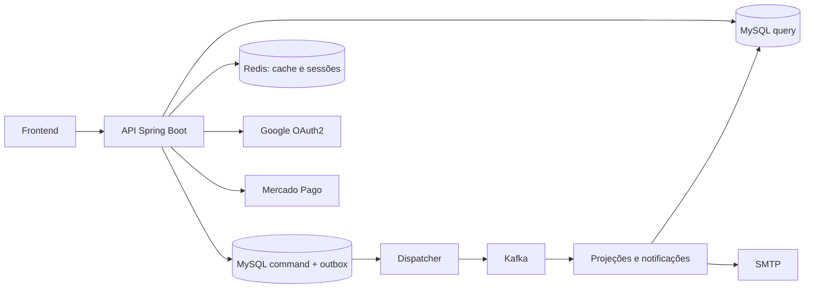

# CQRS — Catálogo, pedidos e pagamentos

Backend de loja com catálogo, reserva de estoque, pedidos e pagamentos PIX, cartão e presenciais. Usa Java 21, Spring Boot 3.5.12, dois MySQL, Kafka e Redis. O frontend é externo a este repositório.

## Como funciona

O lado `command` valida regras e grava a fonte de verdade. Alteração de negócio e evento são persistidos juntos na outbox. Um dispatcher publica no Kafka; consumers atualizam o banco `query`, invalidam caches e enviam notificações. A leitura tem consistência eventual: uma consulta pode demorar a refletir um comando aceito.



## Funcionalidades

- Login Google, JWT em cookies HttpOnly, refresh rotativo e sessões revogáveis no Redis.
- Papéis `USER` e `ADMIN`, CSRF e autorização por proprietário do pedido.
- Categorias, produtos, reposição e reserva transacional de estoque.
- Checkout PIX, cartão e presencial; webhook e cancelamento com estorno quando aplicável.
- Expiração automática de reservas não pagas e e-mails de pagamento/cancelamento.
- Consultas paginadas, cache e administração de DLQ e cache.

## Executar localmente

Instale Docker com Compose v2. Para executar a API no host, use JDK 21 e Maven Wrapper. O Dockerfile fornece o ambiente Java para execução em contêiner.

```powershell
Copy-Item .env.example .env
# Configure os valores conforme docs/configuration.md.
docker compose up -d --wait
.\mvnw.cmd spring-boot:run
```

No Linux/macOS, use `cp .env.example .env` e `./mvnw spring-boot:run`.

Infraestrutura e API no Docker:

```powershell
docker compose --profile app up --build -d --wait
```

Preencha credenciais próprias de bancos, Redis, Google, JWT, Mercado Pago e SMTP. O exemplo contém placeholders. O Compose não inclui frontend nem SMTP. Veja [configuração](docs/configuration.md) e [Docker local](docs/testing/docker-local.md).

| Serviço | Endereço padrão no host |
|---|---|
| API | `http://localhost:8080` |
| Swagger / OpenAPI | `http://localhost:8080/swagger` / `http://localhost:8080/api-docs` |
| Saúde | `http://localhost:8080/actuator/health` |
| Login | `http://localhost:8080/oauth2/authorization/google` |
| MySQL command / query | `localhost:3307` / `localhost:3308` |
| Kafka / Redis | `localhost:9092` / `localhost:6379` |

## Frontend e autenticação

Use a origem de `APP_FRONTEND_URL` e `credentials: 'include'`. Inicie o login por navegação à rota Google. Depois consulte `/api/v1/query/auth/me`. Antes de POST, PUT ou DELETE, obtenha `/api/v1/csrf` e envie o token no cabeçalho retornado.

Cada JWT contém um identificador de sessão validado no Redis. Logout revoga a sessão atual; `logout-all` revoga todas as sessões do usuário. A API não usa sessão HTTP para autenticar chamadas. Veja [controle de acesso](docs/business-rules/access-control.md) e [integração do frontend](docs/api/frontend-integration.md).

## Estrutura

Os pacotes Java ficam em `src/main/java/com/project/cqrs/`.

| Diretório | Responsabilidade |
|---|---|
| `command/` | Autenticação, catálogo, estoque, pedidos, pagamentos, webhook e outbox |
| `query/` | Projeções, consumers e consultas |
| `admin/` | Cache, DLQ e idempotência |
| `notification/` | Templates e envio de e-mails |
| `config/` | Segurança, bancos, Kafka, Redis, rate limit e erros |
| `shared/` | Eventos, enums, tópicos e DTOs |
| `src/main/resources/db/migration/` | Migrações ativas dos dois bancos |
| `src/test/java/` | Testes unitários, de segurança e integração |
| `docs/` | Documentação técnica e operacional |

## Build e testes

```powershell
.\mvnw.cmd test
.\mvnw.cmd verify
.\mvnw.cmd package
```

`test` executa `*Test`, incluindo sessões em Redis via Testcontainers. `verify` acrescenta `*IT`, com dois MySQL, Kafka e Redis. Docker é necessário à cobertura completa. O Dockerfile gera o JAR sem executar testes.

Na última validação da autenticação, 38 testes passaram, incluindo Redis real. A execução geral foi bloqueada por chamadas a `CategoryRepository.findByIdForUpdate` nos testes de produtos; esse método não está definido na interface. Veja [estratégia de testes](docs/testing/testing-strategy.md).

## Documentação

Comece pelo [índice completo](docs/README.md).

| Tema | Guia |
|---|---|
| Arquitetura e transações | [Backend](docs/architecture/backend-architecture.md) |
| Variáveis e integrações | [Configuração](docs/configuration.md) |
| Endpoints e payloads | [API](docs/api/current-api-reference.md) |
| Regras de negócio | [Regras consolidadas](docs/business-rules/business-rules.md) |
| Casos de uso | [Atores e fluxos](docs/use-cases/README.md) |
| Estoque e expiração | [Pedidos](docs/business-rules/orders-and-stock.md) |
| Checkout e devolução | [Pagamentos](docs/business-rules/payments.md) |
| Bancos e migrações | [Dados](docs/database/data-model.md) |
| Diagnóstico e produção | [Operação](docs/deployment/operations.md) |

## Limites atuais

Eventos têm entrega pelo menos uma vez. Não há transação distribuída entre MySQL, Kafka, Redis, Mercado Pago e SMTP. E-mails podem ser repetidos após falhas. Redis é necessário à autenticação; scripts de sessão pressupõem standalone. Rate limit é local por instância. Consulte os guias antes de alterar a topologia.
