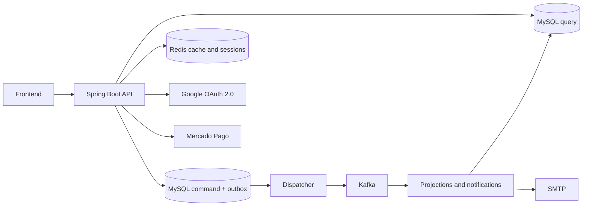

# E-commerce CQRS Backend

A Java backend for an online store with product catalog, inventory, orders, checkout, and payment workflows. The frontend is maintained separately.

## Architecture overview

The command side validates business operations and writes to the source database. Business changes and events are recorded together through an outbox. A dispatcher publishes events to Kafka, and consumers update query projections, invalidate caches, and trigger notifications. Read models are eventually consistent and may take time to reflect a successful command.



## Features

- Google OAuth 2.0 login with JWTs in HttpOnly cookies, rotating refresh tokens, and revocable Redis-backed sessions.
- User and administrator roles, CSRF protection, and order ownership checks.
- Product and category management, inventory restocking, and transactional stock reservations.
- PIX, card, and in-person checkout flows, including payment webhooks and applicable refunds.
- Automatic expiration of unpaid reservations and payment/cancellation email notifications.
- Paginated queries, caching, and administrative dead-letter queue and cache operations.

## Technology and how it is used

| Technology | Role in this project |
|---|---|
| **Java 21** | Main language for the backend, business rules, API endpoints, and asynchronous consumers. |
| **Spring Boot 3** | Runs the REST API and organizes the application into command, query, administration, configuration, and notification areas. |
| **Spring Security** | Applies authentication, authorization, role checks, CSRF protection, and ownership checks for order access. |
| **Google OAuth 2.0** | Provides the user sign-in flow. After authentication, the API issues its own application tokens. |
| **JWT and HttpOnly cookies** | Carry authenticated identity to the frontend. Refresh tokens rotate, and JWT session identifiers are checked against Redis so sessions can be revoked. |
| **MySQL (command database)** | Stores the authoritative business state for changes such as orders and inventory. The outbox record is written in the same database transaction as the business change. |
| **MySQL (query database)** | Stores read projections optimized for queries. Because Kafka consumers update these projections asynchronously, reads can be eventually consistent. |
| **Transactional outbox** | Prevents a committed business change from being lost between the database and message broker: the event is first saved with the business transaction, then a dispatcher publishes it. |
| **Apache Kafka** | Carries domain events from the command side to consumers. Consumers update read projections, invalidate related caches, and trigger notifications. Delivery is at least once, so downstream processing must account for retries. |
| **Redis** | Supports session lookup and revocation, application caching, and related cache administration. Redis is required for authentication in this setup. |
| **Mercado Pago** | Connects checkout and payment flows to an external provider, including webhook-driven payment updates. |
| **SMTP** | Delivers payment and cancellation email notifications from asynchronous notification workflows. |
| **Docker Compose** | Starts the local infrastructure used during development, including the databases, Kafka, and Redis. |
| **Maven Wrapper** | Builds and runs the application with the project's Maven configuration without requiring a separately installed Maven version. |
| **Swagger / OpenAPI** | Publishes interactive API documentation for exploring the endpoints and request/response contracts. |
| **Spring Boot Actuator** | Exposes the application's health endpoint for local operational checks. |

### How the pieces work together

A command request is validated and handled by the Spring Boot API. The API commits the business update and its outbox event together in MySQL. A dispatcher publishes the event to Kafka; consumers then update the query-side MySQL projections and run follow-up work such as cache invalidation or email delivery.

Redis serves a separate purpose from Kafka: Kafka transports events between workflows, while Redis provides fast session and cache lookups. The two MySQL databases also have different responsibilities: the command database is the source of truth, and the query database serves read models.

The architecture does not provide a distributed transaction across MySQL, Kafka, Redis, Mercado Pago, and SMTP. Events are delivered at least once, email delivery may be repeated after failures, and the current rate limit is local to each application instance.

## Run locally

Prerequisites: Docker with Compose v2. To run the API on the host, install JDK 21 and use the Maven Wrapper.

```bash
cp .env.example .env
# Set values as described in docs/configuration.md.
docker compose up -d --wait
./mvnw spring-boot:run
```

On Windows PowerShell:

```powershell
Copy-Item .env.example .env
docker compose up -d --wait
.\mvnw.cmd spring-boot:run
```

To run the API in Docker as well:

```bash
docker compose --profile app up --build -d --wait
```

Set your own credentials for the databases, Redis, Google, JWT, Mercado Pago, and SMTP. The Compose setup does not include a frontend or SMTP server.

| Service | Local address |
|---|---|
| API | `http://localhost:8080` |
| Swagger UI / OpenAPI | `http://localhost:8080/swagger` / `http://localhost:8080/api-docs` |
| Health check | `http://localhost:8080/actuator/health` |
| Google login | `http://localhost:8080/oauth2/authorization/google` |
| MySQL command / query | `localhost:3307` / `localhost:3308` |
| Kafka / Redis | `localhost:9092` / `localhost:6379` |

## Frontend integration

Use the origin configured in `APP_FRONTEND_URL` and send requests with `credentials: 'include'`. Begin login by navigating to the Google authorization route. After login, request `/api/v1/query/auth/me`. For POST, PUT, and DELETE requests, retrieve `/api/v1/csrf` and send the returned token in the indicated header.

Each JWT contains a session identifier that is checked in Redis. Logout revokes the current session; `logout-all` revokes all sessions for the user. The API does not use an HTTP session to authenticate requests. See the [frontend integration guide](docs/api/frontend-integration.md).

## Project structure

The Java packages are located at `src/main/java/com/project/cqrs/`.

| Path | Responsibility |
|---|---|
| `command/` | Authentication, catalog, inventory, orders, payments, webhooks, and outbox |
| `query/` | Read projections, consumers, and queries |
| `admin/` | Cache, dead-letter queue, and idempotency operations |
| `notification/` | Email templates and delivery |
| `config/` | Security, databases, Kafka, Redis, rate limits, and errors |
| `shared/` | Events, enums, topics, and DTOs |
| `src/main/resources/db/migration/` | Database migrations |
| `src/test/java/` | Unit, security, and integration tests |
| `docs/` | Technical and operational documentation |

## Build and tests

```bash
./mvnw test
./mvnw verify
./mvnw package
```

The full integration suite requires Docker. See the [testing strategy](docs/testing/testing-strategy.md).

## Documentation

Start with the [documentation index](docs/README.md).

- [Backend architecture](docs/architecture/backend-architecture.md)
- [Configuration](docs/configuration.md)
- [API reference](docs/api/current-api-reference.md)
- [Business rules](docs/business-rules/business-rules.md)
- [Database model](docs/database/data-model.md)
- [Operations](docs/deployment/operations.md)

## Current limitations

Events are delivered at least once. There is no distributed transaction across MySQL, Kafka, Redis, Mercado Pago, and SMTP. Email delivery may be repeated after failures. Redis is required for authentication, the session scripts assume standalone Redis, and rate limiting is local to each application instance.
