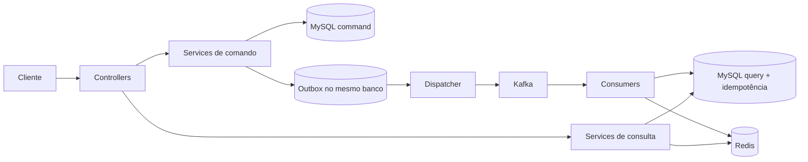

# Arquitetura do backend

## Stack

| Responsabilidade | Tecnologia |
|---|---|
| Linguagem | Java 21, alvo de compilação |
| Framework | Spring Boot 3.5.12 |
| Persistência | Spring Data JPA e Hibernate |
| Bancos | MySQL, instâncias distintas para comando e consulta |
| Migrações | Flyway, histórico por banco |
| Mensageria | Spring Kafka |
| Cache, OAuth2 e sessões revogáveis | Redis standalone |
| Autenticação | Google OAuth2 e JWT em cookies HttpOnly |
| Pagamentos | Mercado Pago SDK Java 3.1.0 |
| Testes | JUnit, Mockito, AssertJ, Testcontainers e Awaitility |

## Camadas

Controllers interpretam HTTP e delegam. Services definem autorização de negócio, transações e estados. Entities mantêm invariantes locais. Repositories encapsulam consultas e bloqueios. DTOs definem os contratos externos; eventos transportam snapshots entre os dois lados.

`command` é a fonte de verdade de catálogo, preço, estoque, pedido e pagamento. `query` é uma projeção que pode atrasar. Uma decisão de compra nunca usa preço ou disponibilidade da projeção.

## Transações

`commandTransactionManager` protege alterações autoritativas e outbox. `queryTransactionManager` protege a projeção e o registro de idempotência. Não existe uma transação distribuída entre MySQL, Kafka, Redis, Mercado Pago e SMTP.

A outbox só é visível ao dispatcher depois do commit. O dispatcher bloqueia um lote pendente, envia eventos e aguarda confirmação. Uma falha mantém o evento pendente e interrompe o lote, preservando sua ordem de publicação. Uma interrupção entre envio e commit pode republicar o evento: a entrega é **pelo menos uma vez**.

Cada consumer registra `(eventId, topic)` na mesma transação da projeção. Se qualquer parte falhar, ambos sofrem rollback. Concorrência é tratada por bloqueio e constraint única; um insert concorrente que perde a corrida deve ser repetido pelo mecanismo de retry.

## Ordem entre tópicos

Tópicos distintos não garantem ordem global. Consumers de pagamento e cancelamento falham temporariamente se o pedido ainda não foi projetado. Pedidos cancelados são terminais e pedidos pagos não regridem para estados pendentes. Kafka usa retry e DLQ para dependências ainda indisponíveis.

## Cache

| Cache | TTL |
|---|---:|
| `products` | 5 minutos |
| `product_details` | 10 minutos |
| `categories` | 30 minutos |
| `orders` | 2 minutos |
| `order-detail` | 5 minutos |

O prefixo é `cqrs:{cache}::`. Detalhes de pedidos incluem proprietário na chave. Paginação inclui página, tamanho e ordenação. A invalidação após atualização da projeção ocorre com o gerenciador de cache configurado como transaction-aware.

## Integrações externas

Mercado Pago é consultado para confirmar estados; o body de um webhook não é fonte de verdade financeira. A assinatura HMAC usa o ID da query string. SMTP envia confirmação de pagamento e cancelamento. Um e-mail pode ser duplicado se o SMTP aceitar a mensagem e o banco falhar antes do commit; não há promessa de exactly-once para SMTP.
## Autenticação

API usa JWT em cookie HttpOnly, sem sessão HTTP. Cada access tem `sid` validado no Redis. Lua torna criação, rotação e revogação atômicas; logout invalida também JWTs copiados. Estado temporário OAuth2 usa Redis e cookie com identificador aleatório. `/me` consulta escrita enquanto a projeção não existir.

Veja [controle de acesso](../business-rules/access-control.md), [modelo de dados](../database/data-model.md) e [eventos](events.md).
