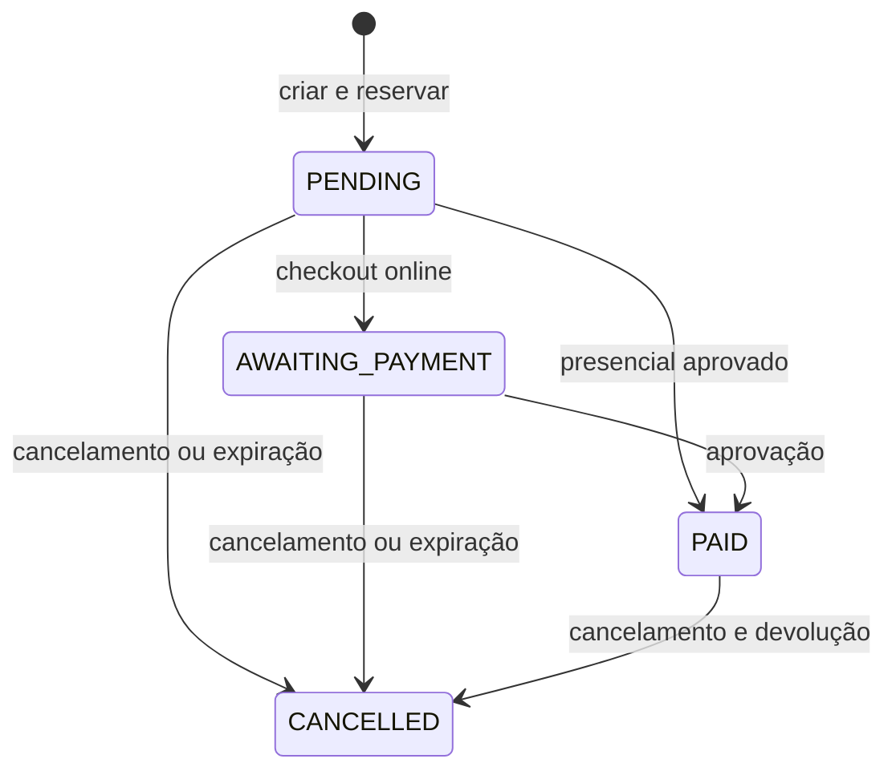

# Regras de negócio

Este documento consolida o comportamento implementado do backend. Os identificadores RN permitem relacionar requisitos aos [casos de uso](../use-cases/README.md). Detalhes HTTP ficam na [referência da API](../api/current-api-reference.md).

## Escopo e vocabulário

O sistema mantém catálogo, estoque disponível, pedidos, pagamentos e notificações. O estoque disponível já desconta reservas. O pedido congela nome e preço dos produtos no momento da criação. Pagamento e pedido têm estados independentes: `APPROVED` é financeiro; `PAID` é estado do pedido.

| Ator | Responsabilidade |
|---|---|
| Visitante | Iniciar login e obter CSRF; não consulta catálogo sem autenticação |
| USER | Consultar catálogo, criar pedidos e operar seus pedidos conforme o pagamento |
| ADMIN | Também gerir catálogo/estoque, confirmar recebimento presencial e administrar recuperação |
| Google | Autenticar identidade externa |
| Mercado Pago | Processar cobrança e fornecer situação financeira |
| Rotinas automáticas | Expirar reservas, projetar eventos e enviar e-mails |

## Acesso e identidade

| ID | Regra |
|---|---|
| RN-001 | Login usa Google; a conta é identificada pelo `sub`, sem senha local. |
| RN-002 | Primeiro login cria conta USER ou ADMIN pela lista configurada de e-mails. Alterar a lista não muda automaticamente contas existentes. |
| RN-003 | Logins posteriores sincronizam o e-mail; não recalculam o papel nem atualizam automaticamente nome/foto no fluxo atual. |
| RN-004 | Operações protegidas exigem sessão ativa. Logout revoga também os JWTs da sessão; logout global revoga todas as sessões do usuário. |
| RN-005 | Escritas do navegador exigem CSRF além da autenticação. Webhook tem assinatura própria e não usa CSRF. |
| RN-006 | Apenas ADMIN modifica catálogo/estoque e acessa ferramentas administrativas. |
| RN-007 | Consulta de pedidos é por proprietário, inclusive para ADMIN. Pedido alheio retorna 404. ADMIN pode cancelar pedidos de outros usuários e registrar recebimento presencial. |
| RN-008 | PIX e cartão exigem proprietário; o papel ADMIN não dispensa essa regra. |

## Catálogo

| ID | Regra |
|---|---|
| RN-009 | Produto pertence a uma categoria existente; categoria/produto ausente impede operação correspondente. |
| RN-010 | Produto requer nome, código, preço e imagem; nome/imagem têm mínimo de cinco caracteres nos DTOs, preço mínimo 0,01. Não há validação de URL da imagem nem unicidade de código no schema atual. |
| RN-011 | Produto novo começa com estoque zero. Quantidade só entra por reposição ou liberação de reserva. |
| RN-012 | ADMIN pode alterar nome, código, preço, imagem e categoria. Alteração não modifica snapshots de pedidos já criados. |
| RN-013 | Categoria com produtos e produto referenciado por itens não podem ser excluídos pela integridade do banco; exclusão não remove histórico em cascata. |
| RN-014 | Catálogo consultado vem da projeção e pode atrasar; decisões de compra usam o banco de escrita. |

## Estoque e pedido

| ID | Regra |
|---|---|
| RN-015 | Pedido recebe uma lista não vazia de IDs e quantidades. Proprietário é o usuário autenticado, não um ID informado pelo cliente. |
| RN-016 | Quantidade de reserva/reposição é positiva; estoque não pode ficar negativo. |
| RN-017 | Produtos repetidos no pedido são agregados. Bloqueios são adquiridos por ID crescente para reduzir deadlocks. |
| RN-018 | Criação reserva estoque imediatamente. Falha em um item reverte a operação, inclusive reservas e eventos locais. |
| RN-019 | Nome e preço vêm da escrita. Total = soma de preço unitário congelado × quantidade, sem frete, desconto ou cupom implementados. |
| RN-020 | Pedido inicia PENDING. 201 confirma gravação; consulta pode retornar 404 temporário até a projeção. Não existe chave geral de idempotência HTTP para criação. |
| RN-021 | Cancelamento bem-sucedido libera a quantidade reservada. Pedido já CANCELLED é rejeitado, sem segunda liberação. |
| RN-022 | Reservas não pagas expiram por padrão após 30 minutos da criação, não do checkout. Scheduler verifica PENDING/AWAITING_PAYMENT em ciclos de um minuto e lotes de até 100. |
| RN-023 | Expiração revalida o estado sob bloqueio; pedido pago durante a espera não é cancelado por essa rotina. Falhas são repetidas em ciclo posterior. |

## Pagamentos

| ID | Regra |
|---|---|
| RN-024 | Checkout não é aceito em pedido PAID ou CANCELLED. |
| RN-025 | Pedido possui no máximo um pagamento ativo: PENDING, IN_PROCESS ou APPROVED. Bloqueio do pedido e índice único sustentam a regra. |
| RN-026 | Valor cobrado vem do total congelado do pedido; cliente não define o valor. |
| RN-027 | PIX pendente de um pedido AWAITING_PAYMENT reutiliza QR code existente. Outro pagamento ativo impede nova cobrança PIX. |
| RN-028 | Cartão com pagamento ativo é rejeitado; o backend recebe token do frontend, não dados completos do cartão. |
| RN-029 | Chaves de idempotência no provedor usam pedido para PIX e pedido/token para cartão; isso não constitui idempotência geral da API. |
| RN-030 | Apenas ADMIN registra presencial após recebimento real. Valores aceitos: CASH, CREDIT_CARD, DEBIT_CARD, PIX. O registro é aprovado localmente, sem operar maquininha ou transferir dinheiro. |
| RN-031 | Aprovação síncrona ou via webhook usa serviço comum: marca pagamento APPROVED e pedido PAID; pedido já PAID não gera nova aprovação. |
| RN-032 | Webhook exige assinatura, correspondência do ID e consulta ao provedor; o body não é a fonte de verdade financeira. |
| RN-033 | Pagamento ainda inexistente localmente no webhook resulta em 503 para repetição. REFUNDED não é reprocessado; notificação não aprovada não rebaixa pagamento já APPROVED. |
| RN-034 | Proprietário pode cancelar pedido, exceto pago presencialmente. ADMIN pode cancelar, inclusive pedido alheio ou presencial. |
| RN-035 | Cancelamento online consulta/cancela/estorna no provedor antes de efetivar localmente. Falha externa preserva pedido e reserva para tentativa posterior. |
| RN-036 | Cancelamento presencial aprovado registra REFUNDED; operador deve devolver fisicamente o valor. Não há integração de devolução em espécie. |
| RN-037 | Aprovação online tardia de pedido CANCELLED solicita estorno, mantém pedido cancelado e registra REFUNDED; falha de estorno exige repetição/conciliação. |

## Eventos, consulta e notificações

| ID | Regra |
|---|---|
| RN-038 | Alteração e evento local são gravados juntos na outbox; projeção e entrega de notificações são assíncronas. |
| RN-039 | Entrega é pelo menos uma vez; consumidores deduplicam por evento/tópico e preservam estados terminais. Não há ordem global entre tópicos. |
| RN-040 | E-mail informa aprovação/cancelamento; sua ausência não desfaz a operação financeira. Falhas de SMTP podem gerar repetição ou e-mail duplicado. |
| RN-041 | Replay exige ADMIN e CSRF, republica mensagens e não apaga a DLQ. Limpar cache não corrige projeção nem altera estoque/pagamento. |
| RN-042 | `/me` consulta escrita enquanto a projeção não existir; outras consultas mantêm consistência eventual e regras de proprietário. |

## Estados do pedido

CANCELLED é terminal. Recusa financeira não cancela automaticamente o pedido: ele pode permanecer AWAITING_PAYMENT até nova tentativa permitida, cancelamento ou expiração. Mudanças de pagamento obtidas por webhook não equivalem sempre a uma mudança de estado do pedido; o fluxo explícito de cancelamento coordena reserva e devolução.

## Limites do comportamento atual

Não estão implementados carrinho persistente, frete, cupons, impostos calculados separadamente, expedição/entrega, gestão HTTP de papéis, unicidade de SKU nem reconciliação financeira automática geral. O prazo `pixExpiration` armazenado é calculado localmente como 30 minutos após a criação do PIX; não representa uma verificação do prazo efetivo do provedor.

Não existe transação distribuída com Mercado Pago ou SMTP. Uma chamada externa aceita antes de falha local exige consulta/repetição com cuidado. Os testes gerais têm a limitação registrada em [estratégia de testes](../testing/testing-strategy.md).

## Referências de implementação

| Grupo | Referência principal |
|---|---|
| Identidade e autorização | [OAuth2](../../src/main/java/com/project/cqrs/command/auth/service/CustomOAuth2UserService.java), [segurança](../../src/main/java/com/project/cqrs/config/security/SecurityConfig.java) |
| Catálogo e reserva | [produtos](../../src/main/java/com/project/cqrs/command/product/service/ProductCommandService.java), [estoque](../../src/main/java/com/project/cqrs/command/product/service/InventoryService.java) |
| Criação e total | [pedido](../../src/main/java/com/project/cqrs/command/order/model/OrderCommandEntity.java) |
| Checkout e aprovação | [checkout](../../src/main/java/com/project/cqrs/command/payment/service/MercadoPagoPaymentService.java), [aprovação](../../src/main/java/com/project/cqrs/command/payment/service/PaymentApprovalService.java) |
| Cancelamento e expiração | [cancelamento](../../src/main/java/com/project/cqrs/command/order/service/OrderCancelledService.java), [scheduler](../../src/main/java/com/project/cqrs/command/order/service/OrderExpirationService.java) |
| Notificação | [consumer](../../src/main/java/com/project/cqrs/notification/consumer/NotificationEventConsumer.java) |

Guias complementares: [acesso](access-control.md), [pedidos](orders-and-stock.md) e [pagamentos](payments.md).
