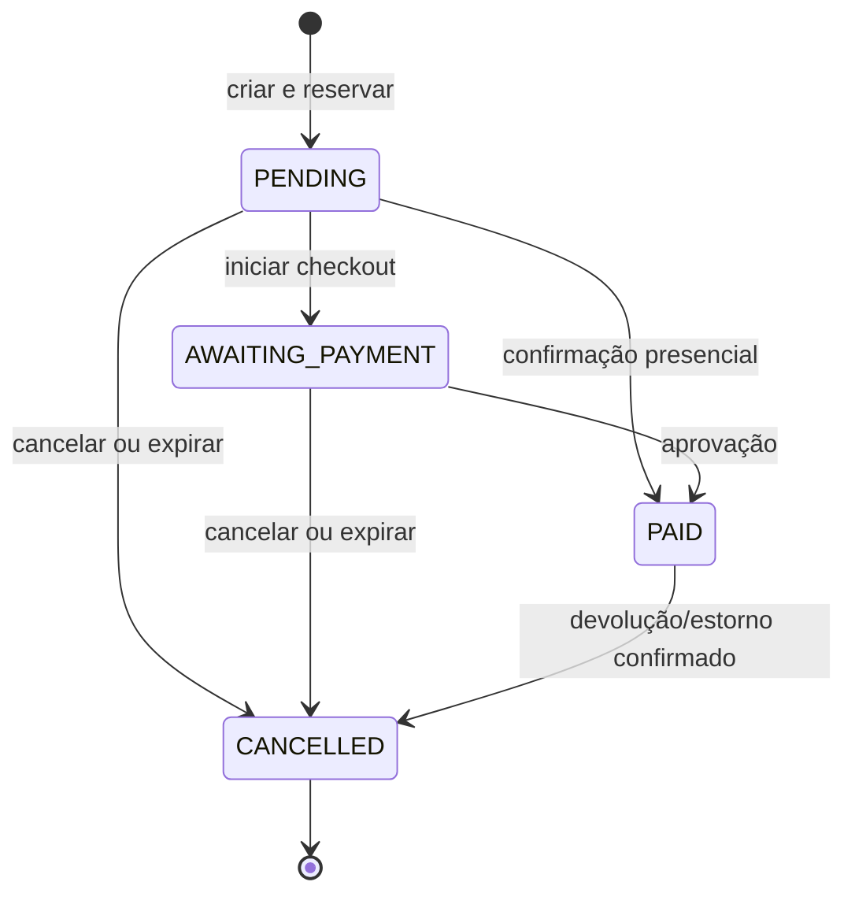

# Pedidos e estoque

## Regras confirmadas

| ID | Regra |
|---|---|
| ORDER-001 | O cliente informa somente IDs de produto e quantidades. |
| ORDER-002 | Preço e nome vêm do banco de escrita e são congelados nos itens do pedido. |
| STOCK-001 | Produto novo inicia com estoque zero; ADMIN abastece pelo endpoint de estoque. |
| STOCK-002 | Criar pedido reserva estoque imediatamente. |
| STOCK-003 | IDs repetidos são agregados antes da reserva. |
| STOCK-004 | Bloqueios pessimistas são adquiridos em ordem crescente de ID para reduzir deadlocks. |
| STOCK-005 | Estoque insuficiente retorna 409 e a transação reverte todas as reservas e eventos da operação. |
| STOCK-006 | Cancelar libera a quantidade reservada; o mesmo pedido não libera estoque duas vezes. |
| STOCK-007 | A reserva de pedido não pago expira em 30 minutos. |

## Estados

O scheduler consulta pedidos pendentes ou aguardando pagamento a cada minuto por padrão. Os 30 minutos contam desde a criação, não desde o último clique em checkout. A efetivação pode ocorrer no ciclo seguinte e atrasar se o provedor de pagamento estiver indisponível. A rotina bloqueia novamente o pedido e não cancela um pedido que já foi pago enquanto aguardava processamento.

Configuração: `ORDER_RESERVATION_MINUTES` e `ORDER_EXPIRATION_POLL_MS`.

## Catálogo e histórico

Excluir um produto referenciado por itens existentes é impedido pela integridade do banco. Categoria com produtos não é removida em cascata. Para alterar a disponibilidade, opere estoque; não apague referências necessárias ao histórico de pedidos.

## Resposta de criação

`POST /api/v1/command/orders` retorna 201, o ID do pedido e um header `Location` apontando para a consulta. A leitura pode retornar 404 temporariamente enquanto a outbox e os consumers processam o evento. O cliente deve repetir a consulta com atraso limitado.